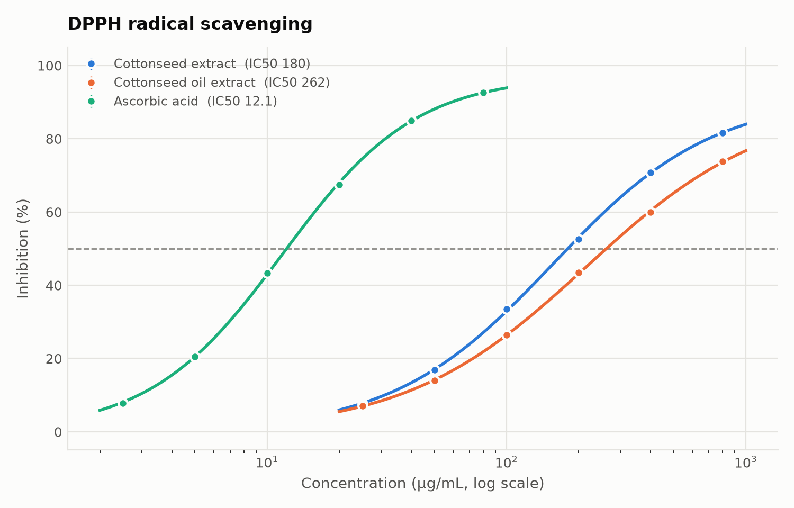
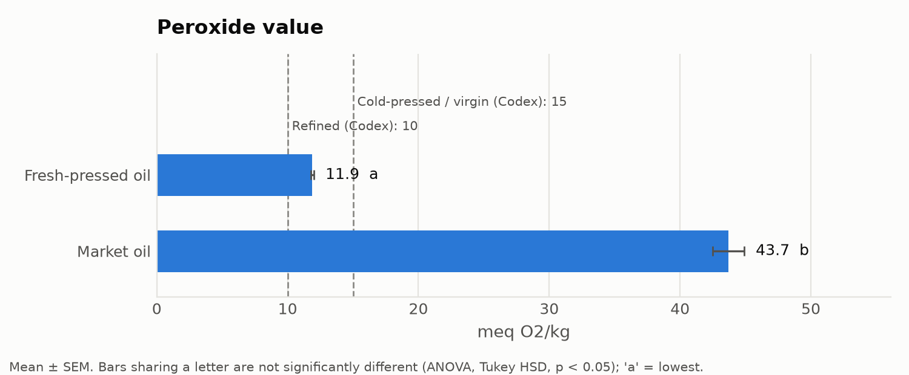
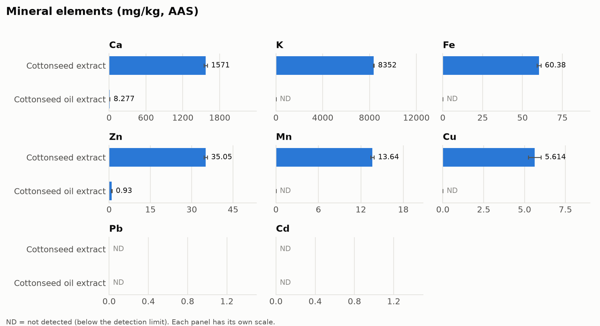

# Assay Analyzer

**Every calculation from my MSc thesis, from raw bench readings to a thesis-ready results table, done the same way every time.**

For my MSc in Medical Biochemistry (University of Benin, 2026) I characterised *Gossypium hirsutum* cottonseed and its pressed oil: phytochemicals, anti-nutrients, antioxidant activity, oil quality and minerals. That came to twelve assays, each run in triplicate.

The bench work was the easy part. Afterwards came copying readings from a notebook into Excel, rebuilding a standard curve for every colorimetric assay, re-typing the same titration formula down a column, and running ANOVA in SPSS to get the superscript letters for each results table. Every step was a chance to make a mistake nobody would catch.

This is the tool I wished I'd had. Give it the numbers you wrote down and it does the calculations, checks the replicates, compares samples statistically, and hands back figures and an Excel report formatted like a thesis table. It also tells you, in plain language, when something in your data looks wrong.



---

## What it covers

Twelve assays in five groups, following the methods chapter of my thesis:

| Group | Assay | Method | Result |
| --- | --- | --- | --- |
| **Phytochemicals** | Total phenolics | Folin–Ciocalteu, 765 nm, tannic acid standard | mg TAE/g |
| | Total flavonoids | Aluminium chloride, 415 nm, quercetin standard | mg QE/g |
| | Total tannins | Folin–Denis, 760 nm, tannic acid standard | mg TAE/g |
| | Alkaloids | Gravimetric (NH₄OH precipitation) | % |
| | Saponins | Gravimetric (n-butanol fraction) | g/kg |
| **Antioxidant activity** | DPPH | Radical scavenging, 518 nm | % inhibition; IC50 for dilution series |
| | FRAP | Fe³⁺-TPTZ reduction, 593 nm, ascorbic acid standard | mg AAE/g |
| **Anti-nutrients** | Phytate | FeCl₃ titration | % phytic acid |
| | Oxalate | KMnO₄ titration | mg/g |
| **Oil quality** | Acid value & %FFA | KOH titration (AOCS Cd 3d-63, Ca 5a-40) | mg KOH/g; % as oleic |
| | Peroxide value | Iodometric titration (AOCS Cd 8-53) | meq O₂/kg |
| **Minerals** | Ca, K, Fe, Zn, Mn, Cu, Ni, Pb, Cd | Wet digestion + AAS | mg/kg, ND below detection limit |

Underneath, these are only **four kinds of calculation**, and the code is organised that way:

1. **Standard curve** (phenolics, flavonoids, tannins, FRAP, minerals): fit A = m·C + c to the standards, read samples off the curve, then convert to mg equivalents per gram of material.
2. **Inhibition** (DPPH): compare the sample to a control.
3. **Titration** (acid value, FFA, peroxide value, phytate, oxalate): titre, normality and mass go into a fixed formula.
4. **Gravimetric** (alkaloids, saponins): residue mass ÷ sample mass.

Adding a new colorimetric assay takes one line: name the standard, the wavelength and the unit.

---

## The science, briefly

### The seed: what's in it, and is it protective?

Cottonseed is rich in **phenolic compounds**, flavonoids and tannins, plus **gossypol**, a yellow polyphenol unique to cotton. Phenolics act as antioxidants in two ways, so two assays are needed:

| Assay | Mechanism | What happens in the cuvette |
| --- | --- | --- |
| **DPPH** | Hydrogen-atom / electron donation to a radical | Purple DPPH• is reduced to yellow DPPH-H; absorbance at 518 nm falls |
| **FRAP** | Electron transfer to a metal | Colourless Fe³⁺-TPTZ is reduced to blue Fe²⁺-TPTZ; absorbance at 593 nm rises |

The seed also carries **anti-nutrients**. Phytate binds iron, zinc and calcium and blocks their absorption. Oxalate does the same to calcium. Both matter if cottonseed meal goes into food or feed.

### The oil: is it going rancid?

Oil spoils by two independent routes, and each has its own titration:

| Assay | Spoilage route | What it measures |
| --- | --- | --- |
| **Acid value / %FFA** | **Hydrolysis**: lipases and moisture cut fatty acids off the triglyceride | Free acid neutralised by KOH |
| **Peroxide value** | **Oxidation**: O₂ attacks unsaturated fatty acids, forming hydroperoxides | Iodine liberated by peroxides, titrated with thiosulfate |

PV rises early in oxidation and then *falls* as hydroperoxides break down into aldehydes, so a low PV alone doesn't prove an oil is fresh. Oil results are plotted against Codex Alimentarius limits for named vegetable oils.



---

## What the tool does

- **Uses the formulas as written in the methods.** Acid value is V × N × 56.1 / W, and %FFA is AV × 0.503. Every per-replicate value is in the output, so any single number can be audited.
- **Reports the way a thesis does.** It gives mean ± SEM (or SD), then one-way ANOVA and Tukey's HSD, with **compact letter display**: 82.35 ± 0.40ᵃ. Letters always mean "best first", so 'a' is the highest phenolic content or FRAP and the lowest IC50, PV or FFA.
- **Compares like with like.** Letters compare samples measured by the same assay. Comparing acid value with peroxide value statistically is meaningless, because they have different units.
- **Checks standard curves.** It warns if R² < 0.99, and flags samples that read outside the standard range so you know to dilute and re-read.
- **Handles AAS detection limits.** LOD = 3 × SD(blank) / slope, per element. Readings below it are reported as **ND**, not as a tiny invented number. If your instrument already reports mg/L, enter that instead of absorbance.
- **Corrects for extract colour (optional).** Cottonseed extracts are yellow and absorb near 518 nm on their own. An `abs_blank` (extract without DPPH) column subtracts that colour, so pigment isn't counted as scavenging.
- **Fits IC50 properly when you have a dilution series.** A dose-response (logistic) curve is the default. Interpolation and linear regression are shown alongside, because linear regression through a sigmoidal curve can be badly off. If 50 % inhibition is never reached, it reports *IC50 > highest concentration* rather than extrapolating.
- **Checks replicates.** It flags any sample whose CV exceeds your limit and names the replicate that deviates most, so you know which notebook entry to recheck.
- **Explains its errors.** A typo such as `5,02` produces *"column 'sample_mass_g' has non-numeric values on spreadsheet row 3"*, not a stack trace.



---

## Using it

### Point and click (for anyone in the lab)

```bash
uv sync --extra app                       # or: pip install -e ".[app]"
uv run streamlit run app/streamlit_app.py
```

It opens in the browser with demo data loaded. Turn off **Use demo data** to upload your own CSV or Excel files, one per assay. **Overview & report** gathers everything into one table and one Excel workbook.

### Command line

Name each file after its assay (`tpc.csv`, `dpph.xlsx`, `peroxide.csv`, …) and put them in one folder:

```bash
uv run assaykit data/demo --out report/   # analyse everything found
uv run assaykit --list                    # every assay and the columns it expects
```

### Python

```python
import pandas as pd
from assaykit import ASSAYS

res = ASSAYS["acid_value"].run(pd.read_csv("acid_value.csv"))
res.summary    # mean, SD, SEM, CV, Tukey letters per sample; %FFA alongside
res.rows       # every titration with its computed value
res.warnings   # plain-language problems found in the data
```

### Getting data in from a notebook

Half my data was handwritten. The templates in [`templates/`](templates/) are laid out the way a notebook page reads: one line per cuvette reading, titration or weighing. Column names are forgiving: `Sample ID`, `sample id` and `sample_id` all work. Titrant normality defaults to the method's value (0.1 N KOH, 0.01 N thiosulfate) unless the file says otherwise. For gravimetric assays you can enter the empty and filled crucible weights, and the tool does the subtraction.

---

## Is it correct?

```bash
uv run pytest
```

There are two kinds of tests:

1. **Hand-calculated cases.** Every formula is checked against a value worked on paper. For example, *5.00 mL × 0.1 N × 56.1 / 5.00 g = 5.61 mg KOH/g → × 0.503 = 2.82 % FFA*, or *A = 0.71 on A = 0.002C + 0.01 → 350 µg/mL × 20 × 10 mL / 1 g = 70 mg TAE/g*. The tests also cover the detection limit, the letter display, SEM, and IC50 on a known curve.
2. **Known-answer recovery.** [`scripts/make_demo_data.py`](scripts/make_demo_data.py) simulates the whole study from chosen "true" values and adds realistic noise. It includes standard curves, blanks, weighing and pipetting error, and trace minerals near the detection limit. The tests check that the analysis gets those values back.

**The demo data is synthetic.** It follows my study design (seed extract, oil extract, ascorbic acid reference, pressed oil), but the numbers are simulated, not my results. Real data goes in `data/private/`, which is git-ignored.

---

## Project layout

```text
src/assaykit/
  assays.py       catalogue of all twelve assays (used by the app and CLI)
  calibration.py  standard-curve assays and AAS minerals, with LOD
  dpph.py         % inhibition and IC50 (three methods)
  titration.py    acid value, %FFA, peroxide value, phytate, oxalate
  gravimetric.py  alkaloids, saponins
  stats.py        mean/SD/SEM, ANOVA, Tukey HSD, compact letters
  plots.py        figures
  report.py       thesis-style overview and Excel report
  cli.py          command line
app/              Streamlit interface
templates/        data-entry layouts, one per assay
data/demo/        synthetic dataset with known answers
tests/
```

## Limitations and next steps

- Long-format input only. Microplate-reader (96-well) layouts are not parsed yet.
- ANOVA assumes roughly normal replicates with similar variances, which is standard practice but worth stating at n = 3.
- Next: a qualitative phytochemical screening log (Dragendorff, ferric chloride, froth tests), correlation of TPC with antioxidant activity across samples, and storage time-course plots for oil oxidation.

## References

- Singleton V.L., Rossi J.A. (1965). Colorimetry of total phenolics with phosphomolybdic–phosphotungstic acid reagents. *Am. J. Enol. Vitic.* 16, 144–158.
- Boham B.A., Kocipai-Abyazan R. (1994). Flavonoids and condensed tannins from leaves of Hawaiian *Vaccinium vaticulatum* and *V. calycinum*. *Pacific Sci.* 48, 458–463.
- Brand-Williams W., Cuvelier M.E., Berset C. (1995). Use of a free radical method to evaluate antioxidant activity. *LWT* 28, 25–30.
- Benzie I.F.F., Strain J.J. (1996). The ferric reducing ability of plasma (FRAP) as a measure of "antioxidant power": the FRAP assay. *Anal. Biochem.* 239, 70–76.
- Harborne J.B. (1973). *Phytochemical Methods.* Chapman & Hall.
- Obadoni B.O., Ochuko P.O. (2001). Phytochemical studies and comparative efficacy of the crude extracts of some homeostatic plants. *Global J. Pure Appl. Sci.* 8, 203–208.
- Lucas G.M., Markakas P. (1975). Phytic acid and other phosphorus compounds of bean (*Phaseolus vulgaris*). *J. Agric. Food Chem.* 23, 13–15.
- Day R.A., Underwood A.L. (1986). *Quantitative Analysis*, 5th ed. Prentice-Hall.
- AOCS Official Methods Cd 3d-63 (acid value), Ca 5a-40 (free fatty acids), Cd 8-53 (peroxide value).
- Codex Alimentarius CXS 210-1999, *Standard for Named Vegetable Oils*.
- Piepho H.-P. (2004). An algorithm for a letter-based representation of all-pairwise comparisons. *J. Comput. Graph. Stat.* 13, 456–466.

## License

MIT
